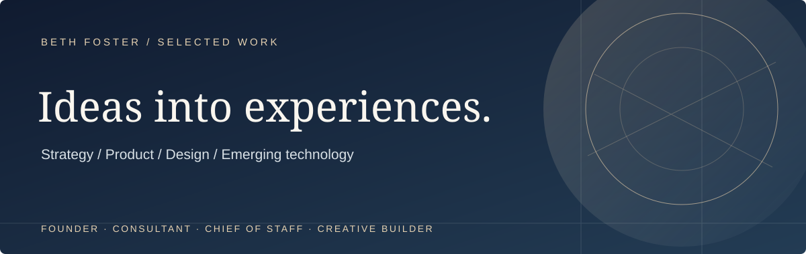
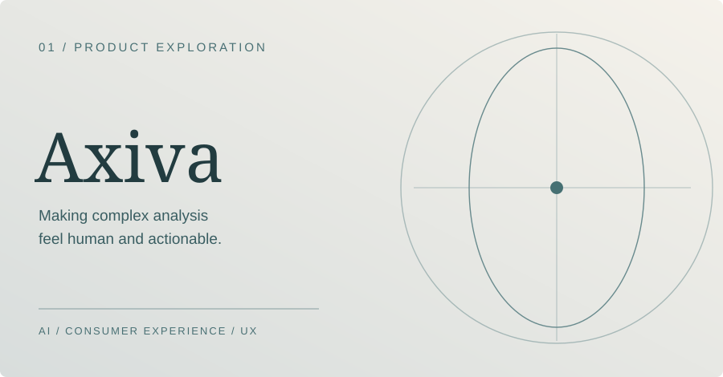
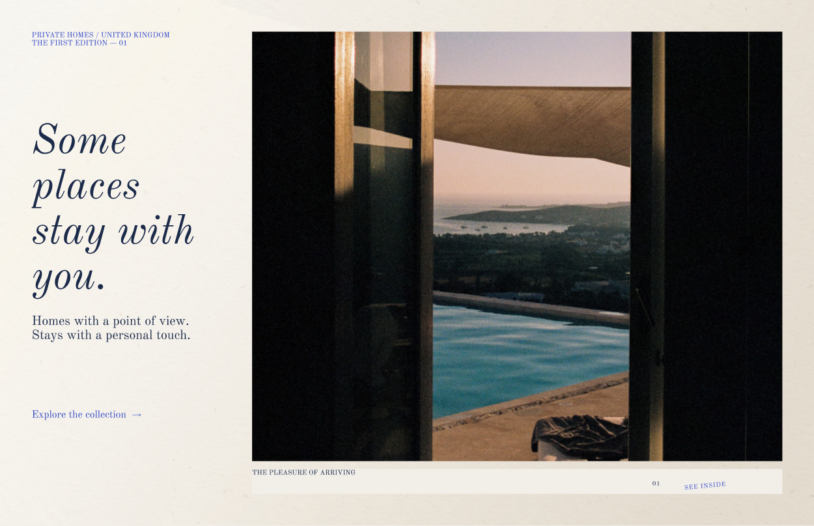

**Founder · Consultant & Chief of Staff · Creative & Product Strategist**

I love getting stuck into big ideas, messy problems and the details that make things work — bringing people together, figuring out what needs to change and making things happen.

[Selected work](#selected-work) &nbsp; · &nbsp; [How I work](#how-i-work) &nbsp; · &nbsp; [EcoGrade.ai](https://ecograde.ai)

---

## Hello, I'm Beth.

I work between the big picture and the detail: spotting opportunities, shaping a proposition, thinking through the customer experience, and helping turn ambitious ideas into something tangible.

I'm **CEO of EcoGrade.ai**, an early-stage business exploring the role of AI in property energy efficiency and retrofit. As a **consultant and Chief of Staff**, I work across industries — including **SaaS, AI, FMCG, beauty, energy, property, marketing and agency businesses** — connecting strategy with the people, systems, creative thinking and execution needed to make it happen.

Outside my core roles, I explore **product design, creative direction and applied AI**. I'm as interested in *how something feels and works* as I am in whether it makes business sense.

## Selected work

I move between founding, advising and building — from commercial strategy to the details of a digital experience. These are a few of the ideas and products I'm shaping.

| **[Axiva — AI product & experience →](projects/axiva.md)** | **[Varenne — Blue identity & UI/UX →](projects/varenne-blue.md)** |
|:---|:---|
| A consumer-facing exploration of AI-assisted analysis, clear guidance, privacy and product journeys. **[Live experience ↗](https://www.axiva.co.uk/)** | Designing an editorial approach to private residences: visual storytelling, collection discovery, search, trust and conversion. **[Explore in Figma ↗](https://www.figma.com/design/bwZg9dIJOWcW8hhOogkRfS/Varenne-T2-V1-%E2%80%94-Private-View---Website-Art-Direction?node-id=0-1)** |

### Also building

**[EcoGrade.ai ↗](https://ecograde.ai)** — As CEO, shaping an early-stage AI and property energy-efficiency venture across product, commercial development and go-to-market.

**The Somewhere** — An early-stage exploration in conversation-led communities and digital membership. *Work in progress.*

---

## How I work

**Think commercially.** Understand the audience, market, proposition and what success needs to look like.

**Design thoughtfully.** Build a coherent experience — from the overarching story to the smallest interaction.

**Make things happen.** Connect ideas to priorities, people, systems, prototypes and delivery.

**Stay curious.** Explore AI and emerging tools as practical ways to create and test new possibilities.

**[Working with me →](projects/working-with-me.md)** — A more personal look at how I think, collaborate and make decisions, informed by my DISC & Motivators assessment.

## What I bring to the table

I'm a generalist by nature, and that's something I see as a strength. I've led businesses and teams, worked closely with founders and CEOs, built products, shaped commercial strategy and helped organisations navigate change. I'm just as happy getting into the detail as I am helping work out the bigger picture.

### What I'm confident doing

**Strategy, leadership & commercial**
- Business and growth strategy, commercial planning, budgets and performance
- Executive advisory and Chief of Staff work — helping leadership turn priorities into action
- Negotiation, strategic partnerships, stakeholder relationships and go-to-market planning
- Building operating models and organisational structures that can actually scale

**People, operations & transformation**
- Building and developing teams, leadership structures and people functions
- Organisational design, workforce planning, performance management and culture
- Cross-functional programme delivery, change management and operational improvement
- Governance, policy development, documentation and putting practical controls in place

**Marketing, product & customer experience**
- Brand and marketing strategy, digital marketing and product marketing
- Value propositions, positioning, customer journeys and conversion thinking
- User-focused product development, UX principles and translating early ideas into useful products
- Turning complex information into clear stories, propositions and experiences

**AI, creative thinking & delivery**
- Research-led AI model development and refinement, agent workflows and practical automation
- Creative direction, brand concepts, design exploration and prototyping
- Planning product infrastructure and working alongside technical teams to bring ideas to life
- Connecting the commercial, creative and operational pieces rather than treating them as separate projects

### The tools I work with

I'm not particularly loyal to software for its own sake. **The right tool depends on the client, the team and the problem.** I can work within an established setup or help introduce something more useful.

| For | Tools and platforms |
| --- | --- |
| Projects & workflows | ChatGPT, Claude, Notion, ClickUp, Confluence, Jira, monday.com |
| Meetings & follow-through | Fireflies for notes, decisions and actions |
| Presentations & content | Gamma, Canva and AI-assisted drafting |
| Governance & knowledge | Notion, Google Drive, Confluence |
| Design & prototypes | Figma, Adobe Creative Cloud, Canva |
| Technical projects & deployment | GitHub, Vercel, AWS |

**My preferences:** ClickUp or Notion for managing work; Vercel for building and deploying web projects. But I adapt to what makes sense for the business.

### Things I'm OK at — and getting better at

**Community building & positioning:** I enjoy thinking about how communities form, what brings people together and how to give them a clear identity and reason to engage. I'm still developing my practical experience in building and growing communities.

**Sales & business development:** I've worked on commercial opportunities, partnerships and propositions, but I want to sharpen my hands-on sales and new-business development skills. It's an area I'm actively improving.

**Finance & financial forensics:** I'm comfortable with financial planning, budgets and commercial performance. I'm developing more depth in the investigative side — getting into the numbers, tracing what's driving the results and spotting what might have been missed.

**Coding:** I have foundational HTML and JavaScript skills. I can work with code, understand product structure and collaborate with engineers, but I'm not a specialist developer.

**Hands-on technical implementation:** I'm comfortable setting up and navigating project environments and using deployment tools, while recognising when deeper engineering expertise is needed.

I like learning by building. I'm not trying to be an expert in every discipline — I'm good at bringing the right knowledge and people together, understanding enough to challenge the thinking, and keeping the work moving.

## Areas I'm exploring

`Product strategy` · `UI/UX` · `AI-assisted prototyping` · `Digital commerce` · `Brand & creative direction` · `Climate tech` · `Business operations`

---

This profile is a curated view of my work and experiments, not a complete record of the businesses or teams behind them. Some commercial and client projects are represented as case studies rather than open-source code.
