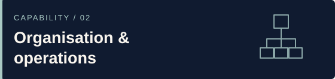
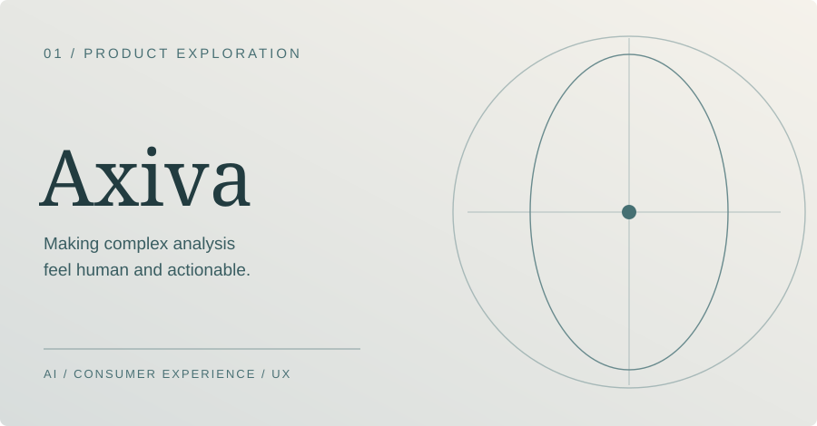
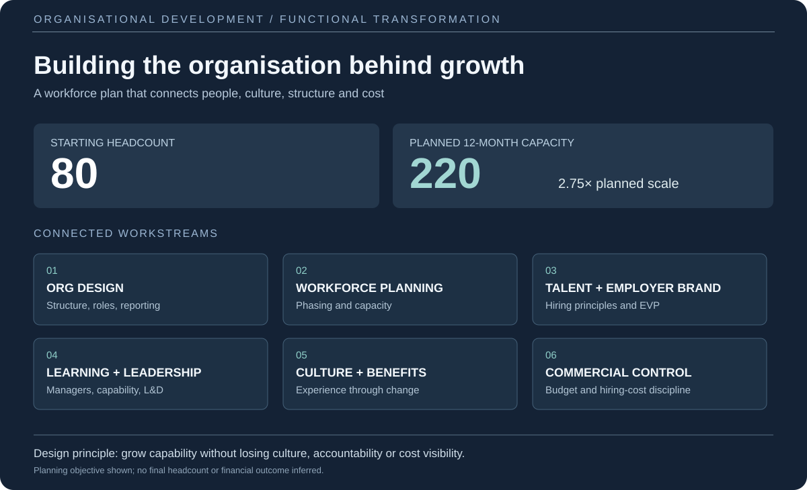

**Fractional Chief of Staff · Business Transformation · Applied AI & Product**

Connecting commercial strategy, organisational change and practical AI implementation.

[Profile](#profile) &nbsp; · &nbsp; [Capabilities](#capabilities) &nbsp; · &nbsp; [Skills hub](#skills-hub) &nbsp; · &nbsp; [Selected work](#selected-work) &nbsp; · &nbsp; [Approach](#approach) &nbsp; · &nbsp; [Engagements](#engagements)

---

## Profile

Founder, consultant and Chief of Staff with experience leading businesses, developing teams and delivering change or GTM across SaaS, AI, property, energy, FMCG, beauty and agency environments.

I work with founders and leadership teams to diagnose business challenges, establish priorities and translate strategy into delivery. My work spans operating models, organisational design, commercial planning, product development and customer experience.

I lead **[EcoGrade.ai](https://ecograde.ai)**, an early-stage venture exploring AI applications in property energy efficiency and retrofit. Alongside my leadership and advisory work, I design agentic workflows and use AI tools to build and test practical solutions.

## Capabilities

<table>
<tr>
<td width="50%" valign="top">

<ul>
<li>Fractional Chief of Staff support and executive advisory</li>
<li>Business and growth strategy, commercial planning and go-to-market development</li>
<li>Strategic partnerships, negotiation and stakeholder management</li>
<li>Leadership priorities, cross-functional programmes and performance reporting</li>
</ul>
</td>
<td width="50%" valign="top">

<ul>
<li>Operating models, organisational structures and workforce planning</li>
<li>Team development, people functions and performance management</li>
<li>Process diagnosis, operational improvement and change implementation</li>
<li>Governance, policy development and knowledge systems</li>
</ul>
</td>
</tr>
<tr>
<td width="50%" valign="top">

<ul>
<li>Product propositions, customer journeys and UX direction</li>
<li>Brand strategy, creative direction and product marketing</li>
<li>Research, prototyping and translating concepts into product requirements</li>
<li>Connecting customer needs with commercial objectives and delivery priorities</li>
</ul>
</td>
<td width="50%" valign="top">

<ul>
<li>Identifying business problems suited to AI and automation</li>
<li>Designing agentic workflows, including information sources, actions, handoffs and human oversight</li>
<li>Building and testing prototypes, tools and workflows using AI-assisted and no-code platforms</li>
<li>Defining requirements, adoption plans and measures of success</li>
</ul>
</td>
</tr>
</table>

My technical contribution centres on business diagnosis, solution design and building with AI. I work with engineering specialists where complex integrations, security or production infrastructure require deeper expertise.

---

## Selected work

Selected projects spanning applied AI, product experience, brand development and organisational transformation.

| **[Axiva — AI product & experience →](projects/axiva.md)** | **[Varenne — Blue identity & UI/UX →](projects/varenne-blue.md)** |
|:---|:---|
| A consumer-facing exploration of AI-assisted analysis, clear guidance, privacy and product journeys. **[Live experience ↗](https://www.axiva.co.uk/)** | Designing an editorial approach to private residences: visual storytelling, collection discovery, search, trust and conversion. **[Explore in Figma ↗](https://www.figma.com/design/bwZg9dIJOWcW8hhOogkRfS/Varenne-T2-V1-%E2%80%94-Private-View---Website-Art-Direction?node-id=0-1)** |

### Organisational development & transformation

**[Designing for growth: 80 → 220 people →](projects/organisational-growth.md)** — How I approached an ambitious, cross-geography workforce plan through organisation design, hiring principles, employer brand, leadership development, culture and budget discipline.

### Ventures

**[EcoGrade.ai ↗](https://ecograde.ai)** — Leading an early-stage AI and property energy-efficiency venture across product, commercial development and go-to-market.

**The Somewhere** — An early-stage exploration in conversation-led communities and digital membership. *Work in progress.*

---

## Approach

**Diagnose.** Understand the underlying problem, the people involved and the commercial consequences.

**Prioritise.** Define the intended outcome, establish ownership and agree a practical scope.

**Design and build.** Map the process or experience, test assumptions and develop a workable solution using the appropriate tools.

**Implement and evaluate.** Support adoption, document responsibilities and assess results against agreed measures.

I work directly with teams throughout delivery, combining strategic oversight with practical involvement.

**[Working with me →](projects/working-with-me.md)** — Collaboration and decision-making preferences, informed by my DISC & Motivators assessment.

## Skills hub

A practical mix of business leadership, product thinking and AI-assisted delivery.

| Discipline | Skills & methods | Tools & platforms |
| :--- | :--- | :--- |
| **Strategy & commercial** | Business diagnosis · Growth strategy · Go-to-market planning · Commercial planning · Strategic partnerships | Notion · Miro · Gamma |
| **Organisation & operations** | Operating models · Organisation design · Workforce planning · Process mapping · Performance management · Governance | ClickUp · Notion · Confluence · monday.com |
| **UX/UI design** | Wireframing, from low to high fidelity · Interactive prototyping · Interaction design · Customer journeys | Figma · Figma Make · Adobe Creative Cloud |
| **Research & insight** | Customer research · Personas · Journey mapping · User testing · Translating findings into product requirements | Miro · Figma · AI research tools |
| **Information architecture & content** | Navigation and content structure · Knowledge systems · Content strategy · Clear user guidance | Notion · Confluence · Google Drive |
| **Brand & product marketing** | Value propositions · Positioning · Creative direction · Product storytelling · Customer experience | Adobe Creative Cloud · Canva · Gamma |
| **Applied AI & agentic workflows** | Problem definition · Agent workflow mapping · Task and data requirements · Human oversight · Prototyping · Adoption planning | Claude · Claude Code · ChatGPT · Base44 |
| **AI-assisted building** | Rapid prototypes · No-code workflows · Product requirements · Deployment workflows · Foundational HTML & JavaScript | Figma Make · GitHub · Vercel · AWS |
| **Delivery & stakeholders** | Cross-functional delivery · Prioritisation · Stakeholder management · Change implementation · Decisions and actions | Jira · ClickUp · Confluence · Fireflies |

### Continuing development

I continue to develop my experience in community growth, direct sales and financial investigation. I have foundational HTML and JavaScript skills, supported by practical experience building with AI and collaborating with technical teams.

## Engagements

Available for **fractional Chief of Staff engagements** and **defined advisory or implementation projects**, including:

- Translating leadership priorities into a coordinated delivery plan
- Reviewing organisational structures, responsibilities and operating processes
- Diagnosing workflow issues and designing practical AI solutions
- Developing product propositions, customer journeys and early prototypes
- Moving stalled initiatives through to implementation

Based in **Amersham, Buckinghamshire**, with access to London.

---

Selected client and commercial work is presented through case studies. Project pages describe the scope and stage of each initiative.
