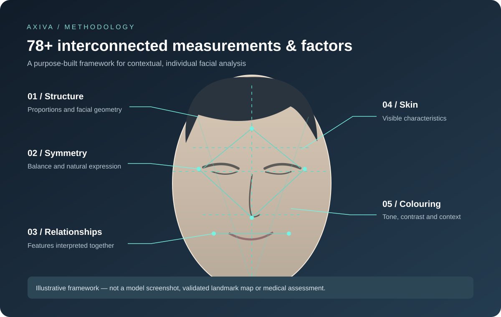
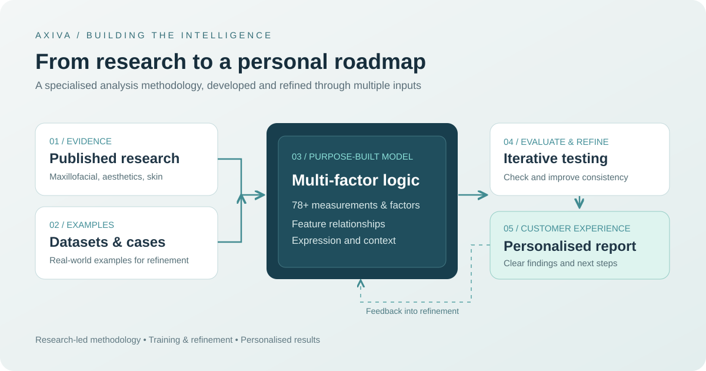

# Axiva

### Building a purpose-trained AI analysis methodology — and making its findings useful

**Discipline:** AI methodology & model training · Research synthesis · Product strategy · Consumer UX · Information design  
**Status:** Live product website · [Visit Axiva](https://www.axiva.co.uk/)

[← Back to portfolio](../README.md)

---

## The opportunity

Facial analysis is often either highly specialist and difficult to access, or reduced to generic observations and subjective beauty scores. I wanted to explore a different approach: **could a purpose-built AI methodology bring together detailed facial measurements, research and individual context, then explain the findings in a way people can actually use?**

Axiva is the product of that work: a consumer-facing analysis experience built around facial structure, symmetry, feature relationships, skin condition and natural colouring.

## What I built: the intelligence behind the experience

*Conceptual illustration of five analysis domains—not a screenshot of the model's actual landmarks or diagnostic output.*

**Axiva is not a general-purpose AI tool simply prompted to assess a face.** I developed its analytical approach specifically for facial assessment: the proportional frameworks, measurement categories, multi-factor interpretation methodology and the way findings are translated into a personalised report.

The methodology draws on a substantial body of published research, including peer-reviewed studies across **maxillofacial surgery, aesthetic medicine and dermatology**. I used extensive datasets, real-world examples and research findings to train and refine the AI's analysis, rather than relying on generic image commentary.

The system evaluates **78+ measurements and factors**, considering their relationships rather than treating each measurement in isolation. Areas include:

- **Facial structure and proportions** — dimensions, balance and proportional relationships
- **Symmetry and expression** — differences between features, taking natural expression into account
- **Feature relationships** — how individual characteristics work together within a unique face
- **Skin condition** — visually observable skin characteristics and considerations
- **Natural colouring** — complexion, contrast and colouring as part of the overall assessment

The central principle is **context over isolated scores**. A finding only becomes meaningful when it is interpreted alongside the person's other features, natural variation and the limitations of photographic analysis.

## Training, research and evaluation

*High-level illustration of the product development and analysis process; not a disclosure of the private model architecture or validation protocol.*

This was as much a research and methodology challenge as it was a product challenge.

| Area | My contribution |
| --- | --- |
| Research foundation | Synthesised a large volume of published studies into an applied facial-analysis framework |
| Training data | Used extensive datasets and real-world facial examples to develop and refine the AI's analytical behaviour |
| Measurement system | Defined 78+ analysis measurements and factors across structure, proportions, symmetry, skin and colouring |
| Interpretation logic | Built a multi-factor approach that considers relationships, expression and individual variation |
| Output design | Structured technical findings into understandable observations and a personalised roadmap |
| Iterative evaluation | Tested and refined outputs against examples to improve consistency and analytical accuracy |

**Reported internal performance:** Up to **98% analysis accuracy** in development evaluations. This is an internally reported figure, not an independently verified clinical accuracy claim; its meaning depends on the evaluation criteria and datasets used.

## Making the analysis usable

The next challenge was to turn a technically detailed assessment into a coherent, approachable experience.

| Product decision | Why it matters |
| --- | --- |
| Clear introduction and photo-upload journey | Make a complex process feel accessible |
| Structured report sections | Help people understand the many dimensions of an assessment |
| Plain-language explanations | Translate technical observations without unnecessary jargon |
| Personalised, staged recommendations | Move from analysis to useful next steps |
| Careful treatment of scores and limitations | Avoid framing appearance as a single objective verdict |
| Privacy and consent messaging | Earn trust before asking for personal images |

## The customer journey

**01 / Discover** — Explain the value of a research-informed, purpose-built analysis without overwhelming users with the underlying complexity.

**02 / Analyse** — Apply the multi-factor methodology across facial features, proportions, symmetry, expression, skin and colouring.

**03 / Understand** — Present findings in plain language, while preserving the nuance of the underlying analysis.

**04 / Act** — Build a practical roadmap around personal priorities, quick wins and further exploration.

**05 / Decide** — Give users agency over next steps and make clear that photo-based analysis is not a clinical diagnosis.

## What this work demonstrates

- **AI research and training:** turning extensive datasets, real-world examples and published evidence into a specialised analytical methodology
- **Systems thinking:** designing an interconnected framework of 78+ measurements and interpretive factors
- **Product invention:** shaping the proposition, underlying methodology and end-user experience together
- **Applied research:** translating specialist literature into a consumer-facing product
- **UX and information architecture:** making complex, sensitive findings understandable and actionable
- **Commercial judgement:** exploring ways to make detailed analysis accessible at a consumer price point

## See the work

**[Explore the live Axiva website →](https://www.axiva.co.uk/)**

*Portfolio note: This case study describes the product creator's work and internal development claims. The underlying datasets, evaluation protocols and private application code are not published here. The performance figure should not be interpreted as independent scientific or clinical validation. Image-based outputs have inherent limitations and are not medical advice.*
