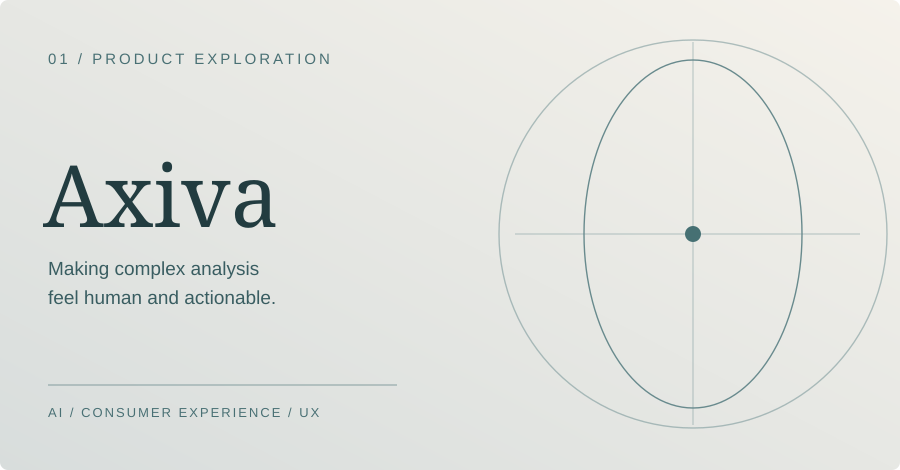
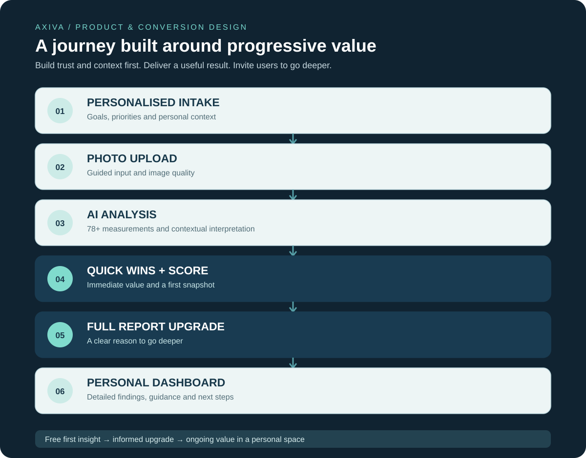

# Axiva — AI research, product strategy & customer experience

### From a specialised facial-analysis methodology to a complete consumer product

**My work:** Product concept & strategy · AI training & research · Analytical methodology · Customer journey & conversion · UX & information architecture  
**Product:** [Visit Axiva](https://www.axiva.co.uk/)

[← Back to portfolio](../README.md)

---

## The opportunity

I wanted to make detailed, personalised facial analysis more accessible without reducing it to generic AI descriptions or a single beauty score. That meant building **both the intelligence behind the analysis and a journey that made the results understandable, useful and commercially viable**.

Axiva brings together a purpose-built analytical methodology, a guided customer experience and a two-stage reporting model: immediate quick wins, followed by a deeper paid report and dashboard.

## 01 / Building the intelligence

Axiva isn't a general-purpose AI tool pointed at faces. **I developed the proportional frameworks, measurement categories, analytical logic and interpretation approach specifically for this product.** I worked with substantial datasets, live examples and a large volume of published research, including peer-reviewed studies in maxillofacial surgery, aesthetic medicine and dermatology.

The framework considers **78+ measurements and factors** across five connected areas:

- **Structure & proportion:** geometry, dimensions and facial balance.
- **Symmetry & expression:** relationships between features, taking natural expression and variation into account.
- **Feature relationships:** how individual characteristics interact rather than treating measurements as isolated scores.
- **Skin:** visible characteristics relevant to a personalised assessment.
- **Natural colouring:** tone, contrast and the relationship between different features.

**The important design decision was to interpret a person as a whole.** A measurement needs context; a useful finding connects that measurement with other features and turns it into something the individual can understand.

## 02 / Research, training & evaluation

This was a significant research and development exercise, not simply prompt engineering.

**Research foundation.** I studied and synthesised a large volume of scientific and specialist literature to inform the analysis categories, proportional references and interpretation framework.

**Model training and refinement.** I worked with datasets and real-world examples, developing and refining the model's ability to apply the methodology consistently across different individual features.

**Multi-factor analysis.** I designed the framework so that structure, symmetry, expression, feature relationships, skin and colouring inform the overall interpretation.

**Testing and iteration.** I compared outputs with examples, refined the methodology and worked to improve consistency and analytical performance.

**Performance achieved in internal development testing: up to 98% accuracy**, as measured within the project's evaluation process.

## 03 / Designing the customer journey

The customer journey was a major piece of the product work. The technical analysis could be valuable, but a complicated intake or a report people didn't understand would undermine the entire proposition.

I designed the funnel around one principle: **ask for the right information, deliver something genuinely useful early, then give people a clear reason to explore further.**

### 01 — Personalised intake

The user starts with a guided questionnaire about their interests, goals and personal priorities.

**Why I designed it this way:** the analysis shouldn't treat everyone as though they're looking for the same outcome. Intake creates context for how results are interpreted and which recommendations will be relevant. The form needs enough information to personalise the experience without creating unnecessary friction.

### 02 — Photo upload

The user submits images through a straightforward, guided upload journey.

**Design considerations:** clear photo requirements, accessible instructions, a sense of progress and a reassuring experience at a moment when users are sharing personal images. The aim is to improve the quality of the inputs while keeping the process simple.

### 03 — AI analysis

The model applies the specialised framework across the 78+ measurements and factors, interpreting findings in relation to the person's unique features and the intake context.

**Design considerations:** turning highly technical analysis into a reliable, understandable output structure, rather than presenting users with raw measurements or disconnected observations.

### 04 — Quick wins page & score

Instead of making someone pay before they can understand the value, the journey delivers an initial **score, a snapshot of findings and personalised quick wins**.

**This is the critical value moment.** It answers the question, *“What did I learn about myself, and what can I do with it?”* The first result needs to be useful in its own right while naturally introducing what a deeper report can provide.

### 05 — Upgrade to the full report

After seeing their initial findings, users have the option to unlock a more comprehensive analysis.

**The conversion logic:** the upgrade is connected to genuine curiosity and demonstrated value, not a premature sales prompt. The customer has already experienced the methodology and can make a more informed decision about going deeper.

### 06 — Full report & personal dashboard

The deeper experience brings the results into a structured, personal space: detailed findings, interpretation, tailored recommendations and a more complete roadmap.

**The product logic:** the report needs to be navigable and actionable, not simply long. Grouping the information clearly and bringing it into a dashboard gives the user a place to return to and work through their next steps.

## 04 / The decisions that made the funnel work

Rather than treating acquisition, analysis and conversion as separate problems, I designed them as one continuous experience.

- **Personalisation before analysis:** the intake establishes context and makes outputs more relevant.
- **Progressive commitment:** a lightweight start leads into photo submission, then results, then an optional paid experience.
- **An early value exchange:** quick wins and a score give users something meaningful before asking them to upgrade.
- **Conversion through demonstrated value:** the paid report builds on the first result, rather than hiding the entire experience behind a paywall.
- **Information hierarchy:** technical findings are translated into plain language, logical sections and practical next steps.
- **A dashboard rather than a one-off document:** the fuller product experience is designed as something useful beyond the first analysis.
- **Trust and clarity throughout:** particularly important when the journey involves personal photographs and highly individual feedback.

## 05 / What I built and what it demonstrates

**AI development & applied research** — Working with specialist research, datasets and real examples to build and refine a purpose-specific analytical methodology.

**Product invention** — Taking an idea from the underlying framework through the customer-facing proposition and experience.

**User-centred UX** — Designing a sensitive, highly personal journey that remains easy to navigate.

**Conversion and product marketing** — Structuring a clear free-to-paid value progression through initial findings, quick wins and a full-report upgrade.

**Information architecture** — Turning a high volume of technical measurements into a structured, understandable report and dashboard.

**Commercial thinking** — Designing accessibility, value delivery and monetisation together rather than as afterthoughts.

---

## Explore the product

**[Visit the live Axiva website →](https://www.axiva.co.uk/)**
