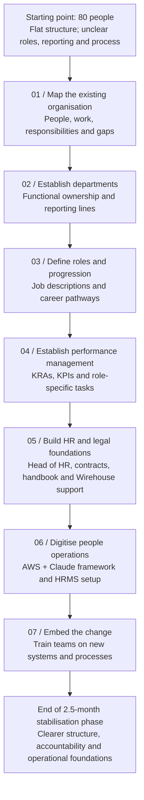
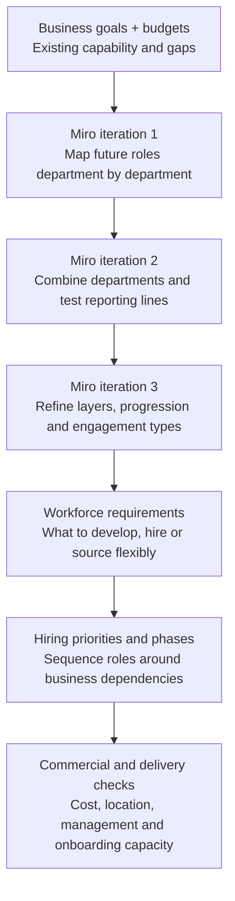
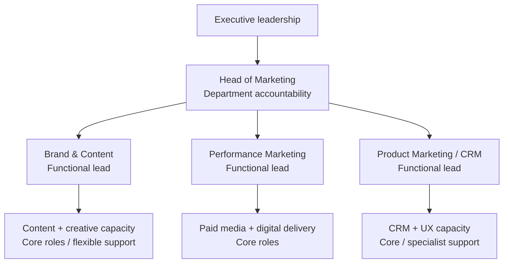

# Organisational development — Designing for growth from 80 to 220 people

### Building the people, leadership and operating foundations for a much bigger business

**Focus:** Organisational design · Workforce strategy · Talent acquisition · Employer brand · Learning & development · Culture · Reward · Budget control  
**Scale of the brief:** Approximately **80 people** at the starting point; a **220-person workforce objective** over **12 months**, across geographies.  
**My role:** Translating a growth ambition into an organisation and people programme capable of supporting it.

[← Back to selected work](../README.md)

---

## Jump to a section

[The challenge](#section-01) · [Stabilise the existing business before scaling](#section-02) · [Design the future organisation and hiring plan](#section-03) · [Employer brand and the employee experience](#section-04) · [Learning, development and leadership capacity](#section-05) · [Protect culture while introducing more structure](#section-06) · [Keep the programme commercially grounded](#section-07) · [How the pieces fit together](#section-08) · [What this project demonstrates](#section-09)

---

## The challenge

Growing from 80 to 220 people in a year isn't simply a recruitment exercise. It changes how an organisation operates: who makes decisions, how managers lead, how people join and develop, how teams collaborate across locations, and how a culture survives significant change.

The challenge was to **create a workforce able to support the business's next phase of growth**, without allowing headcount growth to outpace leadership capability, organisational clarity or financial discipline.

I approached it as an organisation-wide development programme, connecting structure, people and commercial priorities rather than building disconnected HR initiatives.

## 01 / Stabilise the existing business before scaling

**Duration: 2.5 months | Starting workforce: approximately 80 people**

**The starting point wasn't a small version of the future organisation. It was an 80-person business still operating with a largely flat structure.** There were no consistently defined reporting lines or job descriptions, and processes and performance management were largely informal.

Before planning to add another 140 people, I needed to make the existing organisation work properly. Otherwise, growth would compound unclear accountability, inconsistent management and gaps in employee support.

### The approach — from a flat team to a functioning people system

### How I approached the work

**1 — Understand the existing team.** I mapped the work already happening across the business, who was doing it, where responsibilities overlapped and where nobody had clear ownership. The aim was to understand the reality before designing a new structure.

**2 — Create departments and reporting lines.** I moved the flat structure into defined functions, clarifying departmental responsibilities, management ownership and reporting relationships. This created a foundation for decision-making, support and accountability.

**3 — Define roles and progression.** I developed job descriptions, role expectations and clearer paths for growth. Employees needed to understand both what was expected of them and how they could develop as the organisation expanded.

**4 — Make performance measurable.** I established the **key result areas (KRAs), key performance indicators (KPIs) and tasks** associated with each role. This linked job definitions to day-to-day delivery, meaningful performance conversations and development.

**5 — Secure the HR and legal foundations.** I developed employment contracts and the legal foundations needed to better protect the business, brought in a **Head of HR** to help establish a robust employee handbook, and engaged **Wirehouse** for access to external employee relations advice as the workforce grew.

**6 — Put the systems in place.** I digitised the role and performance framework using **AWS and Claude** and created a functioning **HR management system (HRMS) setup** that could support the larger workforce. The aim was to move away from fragmented, informal information and give the organisation practical infrastructure for people management.

**7 — Embed the new ways of working.** I closed the stabilisation phase by **training the team on the new systems and processes**. The project couldn't finish at documentation or software configuration: managers and employees needed to understand how the new framework worked in practice.

### What the first 2.5 months established

By the end of this phase, the organisation had moved beyond its earlier flat, informal model towards:

- Departments with clearer accountability and reporting relationships.
- Defined roles, expectations and progression routes.
- KRAs, KPIs and tasks underpinning performance management.
- Employment contracts and stronger legal foundations, a Head of HR, handbook development and access to Wirehouse employee relations advice.
- Digitised role and performance information, plus an HRMS setup for growth.
- Teams trained to work with the new systems and processes.

**Why it mattered:** this was not simply a reorganisation on paper. I brought together **organisation design, HR capability, governance, performance and technology**, then worked on adoption so the changes could function day to day.

**The shift:** *from 80 people working within an informal, flat structure → to an organisation with clearer departments, role accountability, performance expectations and supporting people infrastructure.*

Only after establishing those foundations could I move confidently into the next stage: **designing the future organisation and workforce plan for the growth ambition.**

## 02 / Design the future organisation and hiring plan

With the first 80-person organisation stabilised, I used what I now knew about **business goals, departmental workload, budgets and geographic needs** to design the next stage of growth. The future structure and hiring plan had to be developed together: there was no point designing roles the business couldn't afford, recruit or support.

This wasn't a remote-first business. Many roles relied on **in-office collaboration and support**, while others were better suited to hybrid, freelance or shared arrangements.

### From departmental design to a sequenced hiring plan

**First, I designed each department.** I mapped leadership, managerial, specialist and junior layers in Miro, clarifying ownership, reporting and progression. Bringing the individual functions together exposed dependencies and gaps that weren't obvious in isolation.

**Then I tested three iterations.** I refined management spans, seniority, reporting lines and where people needed to work. Each revision needed to make operational sense while staying within the commercial realities of the business.

**Finally, I translated the structure into workforce requirements.** The output wasn't simply a list of empty boxes: it became the basis for deciding what capability was missing, what could be developed internally, what needed a permanent hire and where flexible support was more sensible.

### Example — marketing

*Simplified illustrative view of one department. The detailed Miro design also distinguished location, engagement type, reporting and progression; this diagram doesn't represent confirmed hires.*

### How I built the hiring logic

I considered each proposed role against a consistent set of questions:

| Decision | What I assessed |
| --- | --- |
| **Business need** | Which goal, workload or capability gap would this role address? |
| **Timing and dependencies** | Was leadership or infrastructure needed before more junior capacity? What could wait? |
| **Build or hire** | Could an existing colleague grow into the role, or was new expertise required? |
| **Engagement and location** | Permanent, shared or freelance? Office-based or hybrid? What did collaboration actually require? |
| **Cost and affordability** | Salary, associated employment costs, recruitment expense and budget impact |
| **Readiness to support** | Was there a manager, clear role definition, KPIs and onboarding capacity? |

This provided the logic for **phased recruitment**: prioritise roles that unlock delivery and leadership capacity, avoid hiring ahead of the need, and keep the plan adjustable as the business evolves.

### Hiring principles and cost discipline

The design also informed consistent job descriptions and candidate criteria, assessment against the requirements of the role, and a clearer employer proposition. I wanted the organisation to recruit for **the next stage of capability**, not simply replace today's gaps.

Keeping costs controlled meant considering internal progression and flexible support before defaulting to a permanent hire, while tracking planned workforce spend against department budgets. The aim was **the right capability, at the right time, with a clear reason for the investment**.

**The result of this stage:** a department-by-department future structure brought together into a coherent organisation model, with the groundwork for a hiring plan linked to priorities, location, progression, capacity and affordability — rather than a disconnected vacancy list.

## 03 / Employer brand and the employee experience

For a business expanding quickly, recruitment isn't just about attracting applicants. It's about explaining **why someone would want to join and build a career there** — and making sure the experience after they join matches that promise.

I worked on the foundations of the employer proposition: how the organisation presents itself, the expectations it sets, the behaviours it rewards and the experience it wants new colleagues to have.

This had to connect with onboarding, manager readiness, internal communication and the culture being created. An employer brand that isn't reflected inside the organisation doesn't support long-term growth.

## 04 / Learning, development and leadership capacity

Adding people is only useful if the organisation can support them. I considered the development programme as a core part of the scaling infrastructure, rather than an optional benefit.

The work included designing learning and development around changing organisational needs:

- Onboarding and role readiness as teams expand.
- Manager development and clearer expectations of people leadership.
- Capability-building and progression routes.
- Knowledge-sharing and consistent ways of working across functions and locations.
- Identifying the skills that would be required in the future organisation, not just the present one.

The aim was to make growth **sustainable for existing colleagues and new hires alike**.

## 05 / Protect culture while introducing more structure

One of the biggest risks in scaling is losing the qualities that made the earlier organisation work.

I thought about culture as something shaped through everyday systems — the people hired, the behaviours recognised, how leaders communicate, what support employees receive and how decisions are made.

The programme therefore included the **benefits and people-support approach**, alongside manager expectations, internal communication, employee experience and consistent people practices.

The goal wasn't to preserve every informal habit from an 80-person organisation. It was to **keep the strengths worth protecting while creating the foundations a 220-person organisation would need**.

## 06 / Keep the programme commercially grounded

Rapid growth creates pressure on recruitment, salary and operating budgets. It can also introduce expensive inefficiencies if roles are hired in the wrong order or without a clear business requirement.

Financial control was part of the people strategy from the outset:

**Workforce cost visibility** — connect planned headcount, hiring phases and people costs to business planning.

**Recruitment cost discipline** — look for efficient sourcing approaches, clear assessment processes and opportunities to build talent internally.

**Approvals and accountability** — maintain oversight of why positions are required, who owns the decision and how recruitment fits the plan.

**Monitoring as the plan changes** — revisit assumptions and budgets as business priorities, workforce needs and timelines develop.

The intention was not simply to keep hiring costs low; it was to **make sure hiring investment translated into the capabilities the business genuinely needed**.

## How the pieces fit together

| Business question | Programme response |
| --- | --- |
| What must the company be able to do at its next stage? | Future-state organisation and capability design |
| What do we build, develop or hire? | Workforce planning, role architecture and hiring principles |
| Why would the right people join and stay? | Employer proposition, onboarding, culture and benefits |
| Who will support the expanding workforce? | Leadership expectations and L&D programme |
| How do we retain clarity across geographies? | Reporting, ownership, consistent frameworks and collaboration |
| How do we keep growth financially responsible? | Workforce budgets, recruitment-cost monitoring and staged decisions |

## What this project demonstrates

**Organisational thinking at scale.** Designing connected functions, roles and leadership structures rather than managing recruitment in isolation.

**People and culture leadership.** Thinking through hiring, employer brand, development, benefits and employee experience as one system.

**Commercial judgement.** Connecting workforce investment and timing to business objectives and budget visibility.

**Change and programme delivery.** Turning a significant growth ambition into workstreams, principles and foundations that can be developed and implemented.

**A generalist leadership approach.** Working across strategic, operational, commercial and people disciplines to help the organisation prepare for what comes next.

---

### A note on scope

The **80-to-220 figure describes the workforce scaling brief and 12-month objective**. This case study focuses on my organisational design and programme-development work; it does not claim that the final 220-person headcount was achieved or that specific cost savings were realised.

[**← Back to my portfolio**](../README.md)
