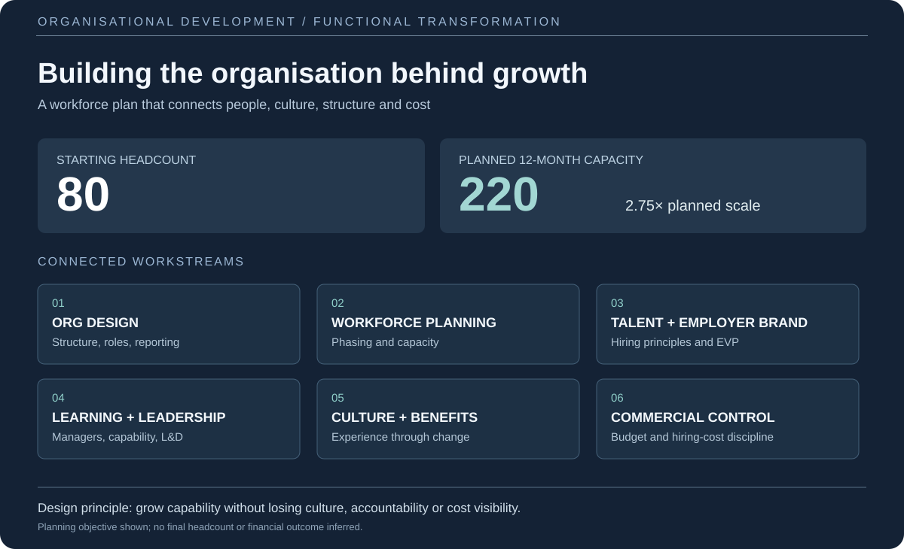

# Organisational development — Designing for growth from 80 to 220 people

### Building the people, leadership and operating foundations for a much bigger business

**Focus:** Organisational design · Workforce strategy · Talent acquisition · Employer brand · Learning & development · Culture · Reward · Budget control  
**Scale of the brief:** Approximately **80 people** at the starting point; a **220-person workforce objective** over **12 months**, across geographies.  
**My role:** Translating a growth ambition into an organisation and people programme capable of supporting it.

[← Back to selected work](../README.md)

---

## The challenge

Growing from 80 to 220 people in a year isn't simply a recruitment exercise. It changes how an organisation operates: who makes decisions, how managers lead, how people join and develop, how teams collaborate across locations, and how a culture survives significant change.

The challenge was to **create a workforce able to support the business's next phase of growth**, without allowing headcount growth to outpace leadership capability, organisational clarity or financial discipline.

I approached it as an organisation-wide development programme, connecting structure, people and commercial priorities rather than building disconnected HR initiatives.

## 01 / Start with the business, not the organisation chart

Before defining the future structure, the important question was **what the business would need to be capable of at its next stage**.

I worked from the growth ambition back to the requirements of each function: its purpose, future workload, leadership needs, dependencies on other teams and where decisions should sit.

This created a foundation for assessing which roles were essential, where management layers were required, what could be developed internally and what capabilities would need to be hired.

**The output:** an organisation design approach grounded in the operating needs of the business — not simply a larger version of the existing team.

## 02 / Design the future organisation

The next piece was building the structure that would support a larger, geographically distributed workforce.

This included thinking through:

- **Functional design:** what each function owns, where responsibilities overlap and how teams work together.
- **Reporting and accountability:** clearer management structures, decision rights and leadership responsibilities.
- **Role architecture:** the distinction between individual contributors, managers, specialist roles and senior leadership.
- **Geographic operating needs:** consistent expectations and collaboration while allowing for local requirements.
- **Scaling in stages:** designing for the next organisation rather than expecting the final structure to appear overnight.

A good structure should make delivery easier. It should also help people understand where they fit and what progression could look like.

## 03 / Build a workforce and hiring plan, not just a vacancy list

Going from 80 to a planned 220 people meant considering **the sequence and economics of hiring**, not simply the total number of roles.

I connected workforce planning to the organisation design, including hiring priorities, capability gaps, role requirements and the order in which teams would need to grow.

I also developed the principles behind recruitment:

- Clearer role definitions and consistent candidate assessment.
- Hiring for capability, adaptability and the needs of the next stage — not only the needs of today.
- A consistent candidate experience and more coherent employer proposition.
- Making better use of internal development and succession opportunities.
- Maintaining visibility over recruitment spend and the full cost of expanding teams.

**The central question:** who needs to join, when, why, and what must be in place for them to succeed?

## 04 / Employer brand and the employee experience

For a business expanding quickly, recruitment isn't just about attracting applicants. It's about explaining **why someone would want to join and build a career there** — and making sure the experience after they join matches that promise.

I worked on the foundations of the employer proposition: how the organisation presents itself, the expectations it sets, the behaviours it rewards and the experience it wants new colleagues to have.

This had to connect with onboarding, manager readiness, internal communication and the culture being created. An employer brand that isn't reflected inside the organisation doesn't support long-term growth.

## 05 / Learning, development and leadership capacity

Adding people is only useful if the organisation can support them. I considered the development programme as a core part of the scaling infrastructure, rather than an optional benefit.

The work included designing learning and development around changing organisational needs:

- Onboarding and role readiness as teams expand.
- Manager development and clearer expectations of people leadership.
- Capability-building and progression routes.
- Knowledge-sharing and consistent ways of working across functions and locations.
- Identifying the skills that would be required in the future organisation, not just the present one.

The aim was to make growth **sustainable for existing colleagues and new hires alike**.

## 06 / Protect culture while introducing more structure

One of the biggest risks in scaling is losing the qualities that made the earlier organisation work.

I thought about culture as something shaped through everyday systems — the people hired, the behaviours recognised, how leaders communicate, what support employees receive and how decisions are made.

The programme therefore included the **benefits and people-support approach**, alongside manager expectations, internal communication, employee experience and consistent people practices.

The goal wasn't to preserve every informal habit from an 80-person organisation. It was to **keep the strengths worth protecting while creating the foundations a 220-person organisation would need**.

## 07 / Keep the programme commercially grounded

Rapid growth creates pressure on recruitment, salary and operating budgets. It can also introduce expensive inefficiencies if roles are hired in the wrong order or without a clear business requirement.

Financial control was part of the people strategy from the outset:

**Workforce cost visibility** — connect planned headcount, hiring phases and people costs to business planning.

**Recruitment cost discipline** — look for efficient sourcing approaches, clear assessment processes and opportunities to build talent internally.

**Approvals and accountability** — maintain oversight of why positions are required, who owns the decision and how recruitment fits the plan.

**Monitoring as the plan changes** — revisit assumptions and budgets as business priorities, workforce needs and timelines develop.

The intention was not simply to keep hiring costs low; it was to **make sure hiring investment translated into the capabilities the business genuinely needed**.

## How the pieces fit together

| Business question | Programme response |
| --- | --- |
| What must the company be able to do at its next stage? | Future-state organisation and capability design |
| What do we build, develop or hire? | Workforce planning, role architecture and hiring principles |
| Why would the right people join and stay? | Employer proposition, onboarding, culture and benefits |
| Who will support the expanding workforce? | Leadership expectations and L&D programme |
| How do we retain clarity across geographies? | Reporting, ownership, consistent frameworks and collaboration |
| How do we keep growth financially responsible? | Workforce budgets, recruitment-cost monitoring and staged decisions |

## What this project demonstrates

**Organisational thinking at scale.** Designing connected functions, roles and leadership structures rather than managing recruitment in isolation.

**People and culture leadership.** Thinking through hiring, employer brand, development, benefits and employee experience as one system.

**Commercial judgement.** Connecting workforce investment and timing to business objectives and budget visibility.

**Change and programme delivery.** Turning a significant growth ambition into workstreams, principles and foundations that can be developed and implemented.

**A generalist leadership approach.** Working across strategic, operational, commercial and people disciplines to help the organisation prepare for what comes next.

---

### A note on scope

The **80-to-220 figure describes the workforce scaling brief and 12-month objective**. This case study focuses on my organisational design and programme-development work; it does not claim that the final 220-person headcount was achieved or that specific cost savings were realised.

[**← Back to my portfolio**](../README.md)
