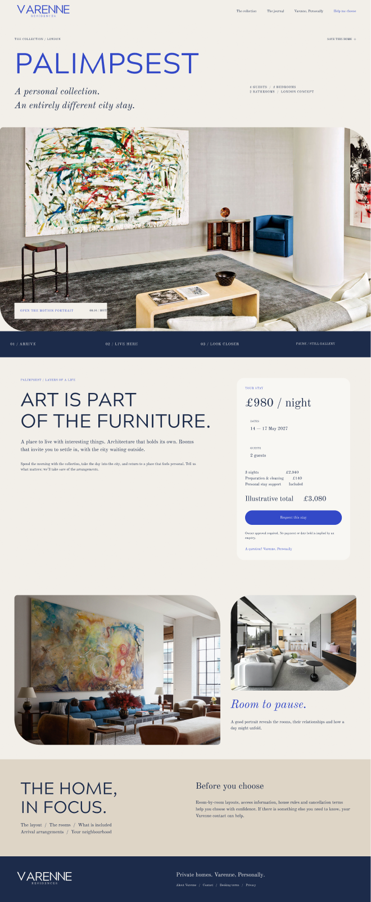

# Varenne Residences — Blue identity

### Designing a private-residence experience around taste, trust and discovery

**Discipline:** Art direction · Brand exploration · UI/UX · Digital commerce  
**Status:** Design exploration / concept work

[← Back to portfolio](../README.md)

---

## Selected screens from the blue-identity exploration

The following are direct captures from the working Figma file, showing distinct moments in the evolving design. They are **concept screens**, not screenshots of a launched site.

### 01 — Editorial arrival

The opening uses visual atmosphere and restrained language before utility. The composition is deliberately closer to an editorial feature than a conventional accommodation search page.

### 02 — Collections and purposeful discovery

The discovery journey introduces property navigation and search in a dedicated context, supporting users who move from inspiration to making a more considered choice.

### 03 — The individual residence

Individual residences become their own stories, allowing architecture, imagery, practical details and the next step in the journey to sit together.

**[View the editable design exploration in Figma ↗](https://www.figma.com/design/bwZg9dIJOWcW8hhOogkRfS/Varenne-T2-V1-%E2%80%94-Private-View---Website-Art-Direction?node-id=0-1)**

---

## The challenge

How do you present a premium private-residence offering without making it look like another accommodation marketplace?

The project explores a more editorial digital experience — one that makes space for architecture, personality, service and confidence while keeping the practical path to discovering and enquiring about a residence understandable.

## The central design idea

**A collection, not a catalogue.**

Rather than leading with a conventional property search box and an inventory grid, the blue identity explores a curated introduction: considered typography, atmospheric property imagery, measured white space and storytelling. The utility becomes prominent when visitors move into the collections experience.

## The design logic

| Principle | Applied in the design | Intended effect |
| --- | --- | --- |
| Lead with atmosphere | Image-led opening and editorial copy | Establish character before asking for a transaction |
| Give the brand room to breathe | Restrained composition, contrast and generous spacing | Convey confidence without visual clutter |
| Sell the individual residence | Distinct property names, stories and visual treatments | Help each home feel considered rather than interchangeable |
| Separate inspiration from utility | Discovery-led homepage; search concentrated in Collections | Preserve the homepage's editorial purpose while maintaining findability |
| Make browsing practical | Map-first exploration, location/date/capacity filters | Support visitors who already know their requirements |
| Earn trust through detail | Clear residence information, service descriptions and discreet trust cues | Reduce uncertainty in a high-consideration purchase |
| Support different decision paths | Availability, booking and human enquiry within the property journey | Accommodate both direct guests and people arranging stays for others |
| Balance physical and digital texture | Soft light, restrained gradients and layered surfaces | Add depth without compromising readability |

## Selected experience flows

### 01 / Homepage — an editorial invitation
The opening frames the brand as a collection of distinctive homes. The purpose of the first screen is orientation, identity and emotional engagement — not simply collecting search criteria.

### 02 / Collections — the point where browsing becomes purposeful
The collection experience introduces more functional navigation. Search parameters and map exploration help people narrow their choices, while photography continues to carry the personality of the residences.

### 03 / Property page — story, then substance
The intended hierarchy moves from an individual property's story and imagery into practical details, the stay proposition and a clear next action. The UX accommodates both exploring and booking.

### 04 / Concierge and membership — service as part of the product
Service, discretion and personal support need to be legible parts of the offering, not secondary marketing copy.

## The creative exploration

The blue direction investigates the balance between classic restraint and contemporary digital interaction: typography with presence, an editorial rhythm, architectural photography, soft light and a carefully controlled accent palette.

This was an iterative design process. The work includes alternate compositions and refinements, rather than one final, production-ready interface.

## View the design

[**Open the Varenne blue-identity Figma file →**](https://www.figma.com/design/bwZg9dIJOWcW8hhOogkRfS/Varenne-T2-V1-%E2%80%94-Private-View---Website-Art-Direction?node-id=0-1)

*Figma access may depend on file permissions. Static frames and annotated before/after design decisions can be added here as approved showcase assets. This public case study does not publish source design assets or client-sensitive information.*

---

**What this project demonstrates:** customer-centred art direction, information architecture, product storytelling, interface design, visual systems and conversion-oriented UX reasoning.
