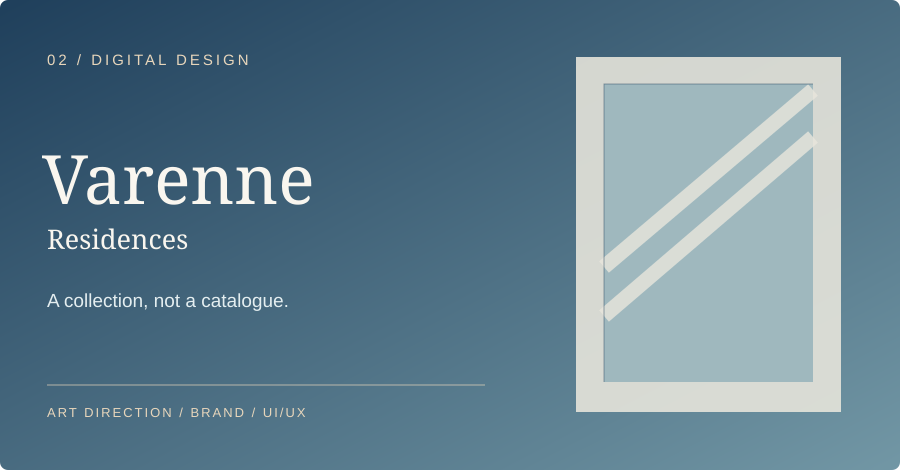
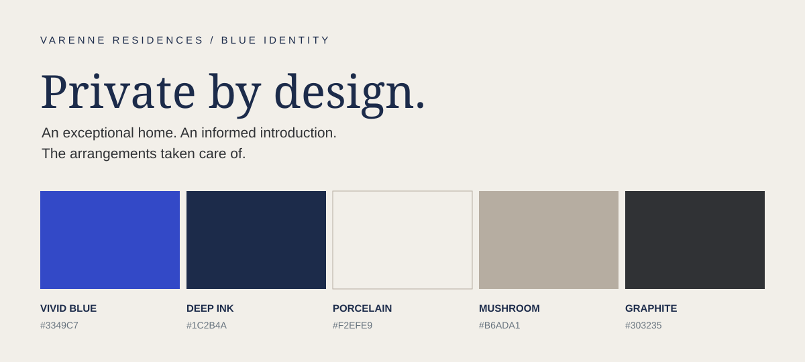
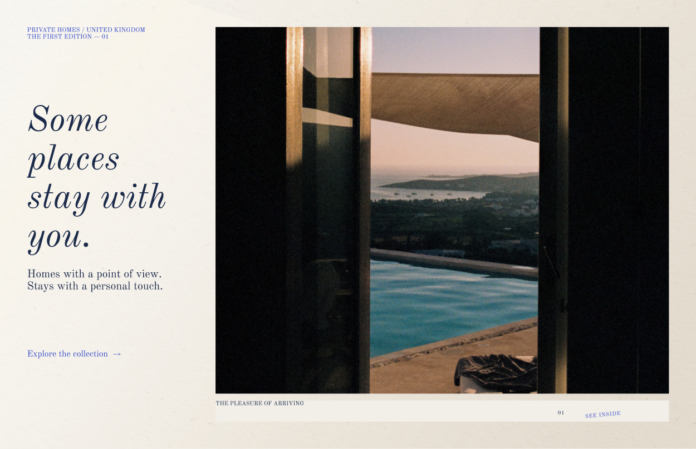
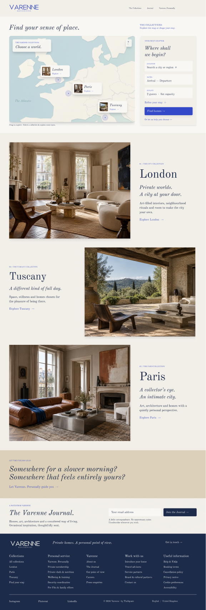
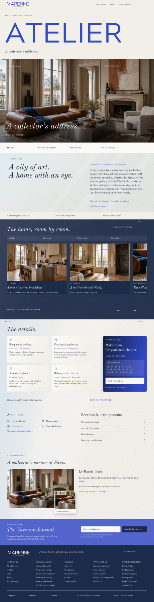

# Varenne Residences — From brand concept to digital experience

### Building a distinctive world for private residences — from naming and creative direction to an editorial, booking-ready experience

**Discipline:** Brand strategy & naming · Creative direction · Visual identity · UI/UX · Digital commerce  
**Status:** Concept development, brand exploration and working Figma prototypes

[← Back to portfolio](../README.md)

---

## The brief

The challenge was bigger than designing a beautiful accommodation website. **How could a private-residence brand communicate taste, privacy, architecture and thoughtful personal service without looking like another property marketplace?**

I explored a brand and product direction in which individual homes have character, discovery feels curated, and concierge is understood as part of the experience. The resulting blue concept connects **brand positioning, visual identity, content direction and the practical customer journey**.

## 01 / Positioning and the name

**The underlying idea: space, privacy and a collector's eye.**

The name *Varenne* references an old French term associated with grazing land and historically with royal hunting reserves. The creative concept takes inspiration from a sense of space and privacy — **not** a claim of inherited estates, royalty or patronage.

The brand proposition is straightforward: distinctive private homes, an informed introduction, and personal care around the stay. I wanted a world with cultural substance and discretion, rather than overt status signalling.

> **“An exceptional home. An informed introduction. The arrangements taken care of.”**

## 02 / A blue identity with editorial restraint

The identity builds contrast between **contemporary energy and quiet composure**. The five core colours form a disciplined system:

| Colour | Hex | Role in the identity |
| --- | --- | --- |
| Vivid blue | `#3349C7` | A deliberate contemporary accent and focal point |
| Deep ink | `#1C2B4A` | A composed anchor for key typography and contrasts |
| Porcelain | `#F2EFE9` | A warm, generous base for editorial compositions |
| Mushroom | `#B6ADA1` | Tactile warmth and understated tonal variation |
| Graphite | `#303235` | Neutral structure and legibility |

A second set of neutral explorations — chalk, oat, cool stone and pewter — supports both warmer, personal touchpoints and cooler architectural contexts. The guiding rule is **lead with light neutrals, anchor with ink, and use vivid blue intentionally**.

### Typography and brand voice

The identity exploration specifies **Cormorant Garamond Semibold** for expressive headlines, **Cormorant Garamond Italic** for annotations and **Manrope Regular** for body copy. The pairing sets an editorial mood without sacrificing clarity in practical information.

The verbal direction is equally considered: confident and informed, but personal rather than performative. Phrases such as *“Private by design”*, *“Make yourself at home”* and *“Your time. Taken care of.”* express the balance of discretion and care.

### Materials, photography and atmosphere

The visual language draws from **uncoated paper, linen, honed stone and brushed metal**. The concept uses one main material texture per composition so tactile interest never becomes visual noise.

Photography centres on architectural distinction, art, objects and lived-in details. It should show both **the entire home and its intimate moments**, creating a point of view beyond a standard property gallery.

## 03 / Extending the identity into an editorial world

The concept is not limited to booking pages. An editorial direction around **art, architecture, people and places** gives the brand room for a journal, collector-at-home stories, neighbourhood perspectives and cultural features.

This matters because the brand needs to feel like a considered introduction to a place — not simply a selection of addresses. The PDF explores this through editorial headlines such as *“The Art of Living”* and *“Through Local Eyes”*.

Personal concierge is expressed through a simple service principle: **understand the guest, know the home, arrange the details, and introduce experiences that genuinely fit**.

## 04 / Translating the brand into a website

The next step was to turn those principles into a coherent digital journey. The working blue-identity Figma file explores the balance between an immersive editorial first impression and the practical tools guests need to make a decision.

### Selected screens from the working Figma exploration

These are captures of **concept screens**, not a launched website.

#### A — Editorial arrival

A visual-first arrival gives architecture, space and brand personality precedence over search. The first interaction invites exploration, rather than immediately requesting dates and a destination.

#### B — Collections and purposeful discovery

The Collections experience introduces more purposeful tools: curated property browsing, navigation, map-led exploration and practical filters. The functional interface arrives at the point where the visitor is ready for it.

#### C — The residence and booking experience

The Atelier page connects the identity with the conversion journey: editorial property storytelling, imagery and details, availability, booking and the option to speak with the team. Its intended hierarchy is **story → images → practical details and booking → lifestyle and service**.

**[Explore the working blue-identity Figma file ↗](https://www.figma.com/design/bwZg9dIJOWcW8hhOogkRfS/Varenne-T2-V1-%E2%80%94-Private-View---Website-Art-Direction?node-id=0-1)**

## 05 / The design decisions behind the work

| Decision | Reasoning |
| --- | --- |
| Build a distinct identity before interface components | Give the product a coherent point of view and consistent visual rules |
| Use blue as an accent, not a blanket treatment | Combine contemporary confidence with editorial restraint |
| Start with atmosphere and individual home stories | Create emotional connection before a transaction |
| Keep search concentrated in Collections | Let the homepage introduce the world while giving intentional visitors useful tools |
| Use a map and practical filters for discovery | Support visitors comparing residences by real requirements |
| Connect the residence story to booking | Make the move from inspiration to decision more natural |
| Keep human enquiry alongside direct booking | Recognise that not every guest or representative wants the same booking path |
| Treat concierge as part of the offering | Communicate personal service, knowledge and discretion throughout the journey |
| Design with texture, negative space and hierarchy | Add depth and character without compromising usability |

## 06 / What I brought together

This case study demonstrates work across several connected disciplines:

- **Brand and proposition development** — shaping the idea, naming rationale, positioning and emotional cues
- **Art direction** — building the colour system, typography direction, material palette, imagery and editorial language
- **Customer experience strategy** — connecting discovery, reassurance, personal service and conversion
- **Information architecture and UI/UX** — separating brand-led browsing from practical search, property details and booking
- **Creative iteration** — exploring variations in visual weight, light, texture, navigation and page hierarchy

**The core idea:** build one coherent brand world, from the first impression to the moment someone chooses a home.

---

## Explore the work

**[Open the blue website art-direction and UI/UX exploration in Figma →](https://www.figma.com/design/bwZg9dIJOWcW8hhOogkRfS/Varenne-T2-V1-%E2%80%94-Private-View---Website-Art-Direction?node-id=0-1)**

*Source: “Varenne Residences — Idea Two / Editorial Identity in Blue”, a nine-page concept deck, alongside the working blue-identity Figma designs. Some deck pages are exploratory and retain earlier naming or typography-layout studies; the case study focuses on the Varenne direction. Mock-ups and Figma captures represent creative concepts rather than a live, validated customer experience. Client-sensitive source assets and commercial information are not published.*

**What this project demonstrates:** brand strategy, creative direction, visual systems, editorial storytelling, product thinking, information architecture, UX and conversion-oriented design.
