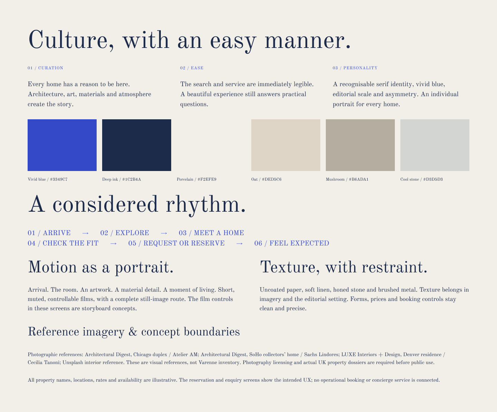
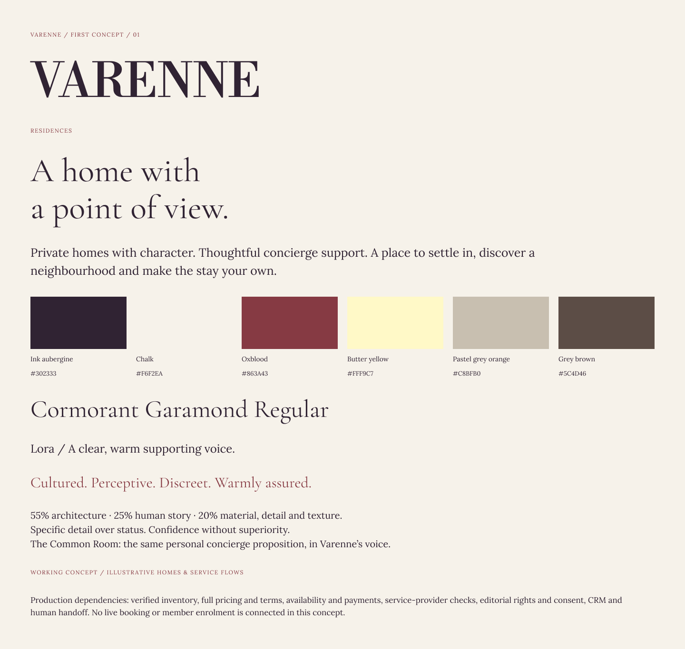

# Varenne Residences — Creating a brand from an open brief

### Turning one exploratory conversation into two brand directions, then making the ideas tangible through product design

**My work:** Brand strategy & naming · Creative direction · Two identity concepts · Brand decks · UX & product thinking · Figma prototypes  
**Stage:** Early concept exploration — before a defined proposition or launch plan

[← Back to portfolio](../README.md)

---

## Jump to a section

[The starting point: more questions than answers](#section-01) · [Two directions, one emerging proposition](#section-02) · [Building the identity — not just choosing colours](#section-03) · [Taking the thinking into Figma](#section-04) · [What the design process was really solving](#section-05) · [What this demonstrates](#section-06)

---

## The starting point: more questions than answers

This wasn't a conventional brief where a business had an established identity, defined customers and a clear product waiting for a website.

The private-residences proposition was still taking shape. Following **one coached discovery conversation and a handful of early ideas**, there were substantial unanswered questions about the audience, positioning, service offer and what the brand should feel like. The project lead couldn't yet give definitive answers — because the vision itself hadn't been fully developed.

**So the design work needed to do something different: help define the business, not simply express it.**

I took the loose starting points, researched the space, interpreted the potential customer needs and built two genuinely different creative routes. The aim was to give the people behind the project something concrete to react to, challenge and refine.

## 01 / Two directions, one emerging proposition

I developed **two separate brand concepts and presentation decks**, each with its own visual personality, language, typography, palette and approach to private residences and personal service.

### Direction A — Blue / editorial and contemporary

**The thought:** Architectural, cultured and confident — a gallery-like approach with generous space, editorial storytelling, tactile neutrals and a deliberately vivid blue accent.

This route asks whether the brand could appeal through **taste and discovery rather than conventional signals of exclusivity**. Homes have individual identities; imagery, materials and atmosphere lead; concierge feels personal rather than ceremonial.

### Direction B — Aubergine / heritage mood with contemporary accents

**The thought:** Warmer, more intimate and established in character, using aubergine, oxblood, chalk and butter yellow, expressive typography and an understated membership sensibility.

This route offered a different emotional reading of the same possible service: more private-club than gallery, but still centred on distinct homes and considered care.

**Why develop both?** At this stage, picking one polished visual identity would have hidden some of the most important questions. Two contrasting, developed routes gave the team a way to discuss the audience, the desired tone, the level of formality and the kind of business they actually wanted to build.

## 02 / Building the identity — not just choosing colours

The brand decks made the ideas tangible across **naming and positioning, visual systems, photography, materials, language and service personality**. They were conversation tools as much as design proposals.

In the blue direction, for example, I explored the name *Varenne* through associations with space and privacy. The creative work paired architectural photography, tactile materials such as linen and stone, editorial typography and a restrained palette with the vivid blue used as an accent.

The underlying idea was simple: **a collection, not a catalogue**. Each home should have a point of view, and the brand should feel like an informed introduction rather than a generic listing platform.

The aubergine direction tested the alternative: the same emerging offer presented with a more intimate, established and discreet visual character.

These were **design hypotheses**, not conclusions drawn from a fully defined business plan. Creating the concepts was a way to move those discussions forward.

## 03 / Taking the thinking into Figma

I didn't stop at brand decks. I began building both creative directions into website concepts to test how the personality would behave when a guest actually needed to browse, evaluate and enquire about a home.

The screens below focus on the **blue route**. They are working design concepts, not a launched booking service.

### A / Arrive — establish character before utility

The homepage leads with space, photography and story rather than forcing a search immediately. It gives the brand a recognisable personality while inviting people into the collection.

### B / Discover — make the collection useful

The Collections hub is where the experience becomes more functional: destinations, dates, capacity, map-led discovery and curated homes. **The shift from inspiration to utility happens intentionally.**

### C / Decide — bring story, service and booking together

The individual residence page connects **property story → imagery → details and availability → booking or human assistance**. It was important that the editorial ambition didn't make the transaction hard to understand, particularly for guests or representatives organising stays.

[**Explore the blue Figma design →**](https://www.figma.com/design/bwZg9dIJOWcW8hhOogkRfS/Varenne-T2-V1-%E2%80%94-Private-View---Website-Art-Direction?node-id=0-1)

## 04 / What the design process was really solving

This wasn't just a visual exercise. The work helped put structure around decisions that hadn't yet been made:

- **Who are we speaking to?** Explore how different visual approaches might resonate with private guests, younger affluent travellers and people arranging stays on someone else's behalf.
- **What are we selling beyond a property?** Bring curation, discretion, knowledgeable service and concierge into the proposition.
- **How should it feel?** Contrast two coherent identities to make abstract preferences easier to discuss.
- **How will someone use it?** Map the journey from editorial introduction to search, property confidence and a clear next step.
- **What needs deciding before launch?** Use the prototypes to surface questions about inventory, availability, booking, service responsibilities and the operating model.

The value of the work was **making an ambiguous vision discussable and testable**. Instead of waiting for a perfect brief, I built enough of the possible futures for the team to make more informed choices.

## What this demonstrates

**Strategic interpretation** — finding a starting point when positioning, audience and service definition are still open.

**Creative range** — developing two distinct brand worlds from the same limited input rather than producing minor variations of one idea.

**Brand-to-product thinking** — carrying the logic from naming, language, materials and identity through to the structure of a digital experience.

**Product and UX design** — balancing storytelling with practical discovery, trust, booking and personal assistance.

**Initiative and delivery** — taking an uncertain conversation and turning it into substantial brand presentations and working prototypes that others could evaluate.

---

[**Back to selected work →**](../README.md)
