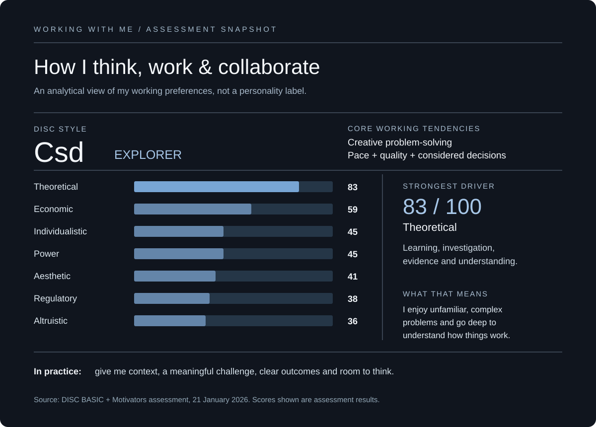

# Working with me

### Curious by nature. Practical by necessity. Rarely short of ideas.

[← Back to my GitHub profile](../README.md)

*The data in this graphic comes from my **DISC BASIC™ + Motivators assessment (21 January 2026)**. My reported behavioural style is **Csd / Explorer**; my highest motivator is **Theoretical (83/100)**.*

---

## A little about how I think

I like understanding how things work, finding opportunities people might have missed and turning complicated ideas into something useful. I can move between strategy, people, systems and creative work — sometimes within the same afternoon.

The assessment describes my **Explorer** style as a creative change agent: someone who likes solving difficult problems, making progress and maintaining a high standard of quality. That combination feels relevant to much of my work, particularly when I'm building something from an early idea or navigating a messy, cross-functional challenge.

## What motivates me

**Curiosity and learning.** My strongest reported motivator is Theoretical. I enjoy research, asking questions, exploring unfamiliar industries and getting beneath the surface of an issue. Understanding the *why* matters to me.

**Making things better.** I get energy from solving practical problems, developing more effective systems and seeing ideas translate into real improvements.

**The freedom to think and build.** I work well with meaningful ownership: a clear goal, enough context, access to the right people and space to figure out the best route.

**Good people and shared outcomes.** I don't need every good idea to be mine. I enjoy supporting other people's thinking, bringing different perspectives together and building things that work for the people using them.

## How I make decisions

I'm generally quick with everyday operational decisions. On bigger or higher-risk decisions, I want to understand the options, the evidence and the consequences.

That can be a strength when something needs careful thought, but it can also mean spending too long investigating when there is already enough information to move forward. I'm conscious of knowing when to keep exploring — and when to make the call.

## How I collaborate

I like direct, constructive conversations. Tell me what you're trying to achieve, what's getting in the way and what needs a decision.

I value people who think independently, challenge ideas thoughtfully, communicate openly and follow through. I also know that not everyone communicates or processes information the same way, so making space for different approaches matters.

A lot of my work sits between disciplines: commercial priorities, people, process, design, AI and delivery. I enjoy making those different perspectives work together.

## How to get the best out of me

- **Share the context and the outcome.** I'm much more useful when I understand why we're doing something, not just what needs doing.
- **Bring me an interesting problem.** I enjoy complexity, ambiguity and finding a practical way through.
- **Be clear and candid.** Direct feedback, useful evidence and honest discussion make collaboration easier.
- **Give me ownership.** I work well with autonomy and clear accountability, without unnecessary oversight.
- **Make room for thinking and iteration.** I can move quickly, but I also care about the quality of what gets delivered.
- **Follow through.** Reliable decisions, clear responsibilities and momentum matter to me.

## What I'm continuing to work on

My appetite for ideas and my standards for quality can pull against each other. I can see several possible routes at once, which is useful at the start of a project but less useful if it delays a decision.

I'm actively working on sharing more of the reasoning behind my decisions, inviting input earlier, and recognising the point at which something is ready to ship. I want to balance curiosity and attention to detail with the ability to keep people and projects moving.

---

## About the assessment

These reflections were informed by my **DISC BASIC™ + Motivators** assessment, completed **21 January 2026**, alongside my own experience working across businesses and projects.

The assessment categorises my behavioural profile as **Csd / Explorer** and measures seven motivational dimensions. The published scores shown in the visual are: **Theoretical 83, Economic 59, Individualistic 45, Power 45, Aesthetic 41, Regulatory 38 and Altruistic 36**.

I find the assessment useful as a vocabulary for discussing preferences, motivations and collaboration, rather than a fixed definition of personality. The interpretations above are my own distillation of what feels useful in working relationships.

**[See selected projects and tools on my main profile →](../README.md)**
